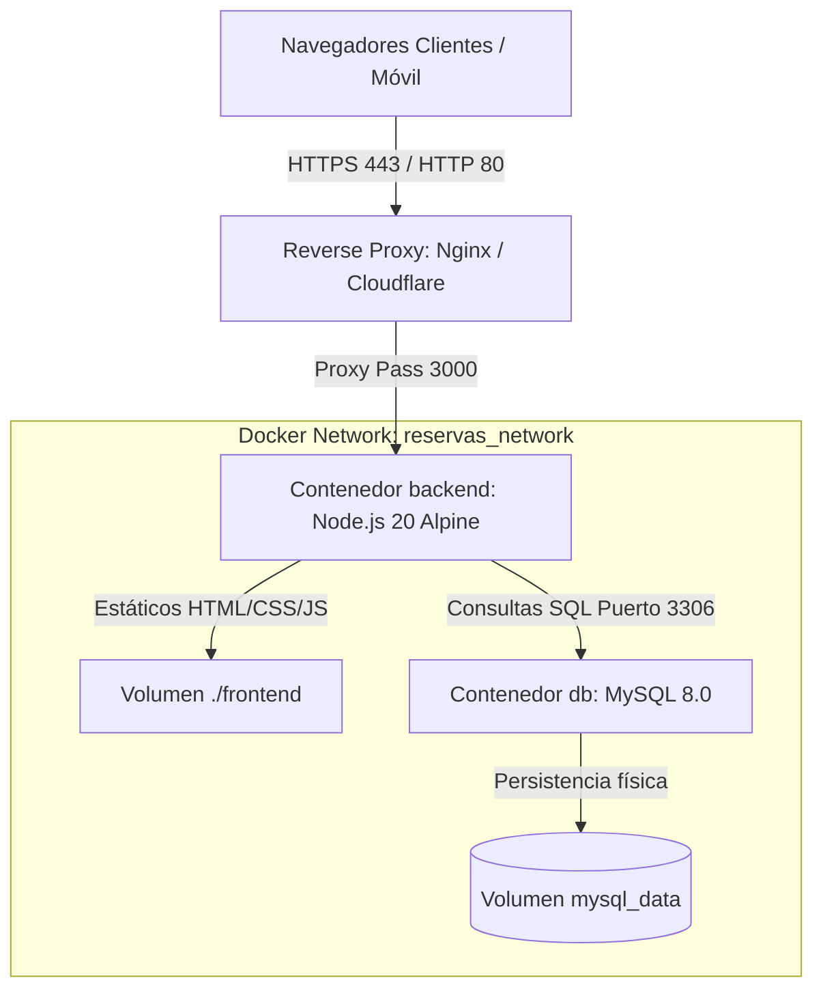

# Guía de Despliegue, Mantenimiento & DevOps — SportReserve

Esta guía contiene los procedimientos técnicos para el despliegue en producción, mantenimiento preventivo, gestión de respaldos (*backups*) y solución de incidencias operativas de la plataforma **SportReserve**.

---

## 1. Requisitos del Sistema

### 1.1 Entorno Local / Desarrollo
- **Sistema Operativo**: macOS, Linux (Ubuntu/Debian) o Windows con WSL2.
- **Docker**: Versión 24.0+ y Docker Compose v2+.
  - En macOS con arquitectura Apple Silicon / Intel: Se recomienda [Docker Desktop](https://www.docker.com/) o [Colima](https://github.com/abiosoft/colima) (`colima start --cpu 2 --memory 4`).
- **Recursos mínimos**: 2 CPU cores, 2 GB de memoria RAM libre, 5 GB de espacio en disco.

### 1.2 Servidor de Producción (VPS o Cloud)
- **Servidor recomendado**: Ubuntu 22.04 LTS o 24.04 LTS (AWS EC2, DigitalOcean Droplet, Linode o Hetzner).
- **Recursos recomendados**: 2 vCPU, 4 GB RAM, 25 GB SSD NVMe.
- **Puertos de Red Requeridos**:
  - `80/tcp` (HTTP) y `443/tcp` (HTTPS) para el tráfico web público.
  - `3000/tcp` (Interno para el backend Express).
  - `3306/tcp` (Interno de Docker para la base de datos MySQL; **nunca exponer al internet público**).

---

## 2. Arquitectura de Despliegue en Docker



---

## 3. Procedimiento de Puesta en Marcha

### 3.1 Paso 1: Clonar y Configurar Entorno
```bash
git clone https://github.com/medinasixcedarlimanul/reservas-canchas-futbol.git
cd reservas-canchas-futbol
cp .env.example .env
```

### 3.2 Paso 2: Personalizar Variables de Entorno (`.env`)
En un entorno de producción, es obligatorio sustituir las contraseñas y llaves de ejemplo:
```env
# Seguridad Base de Datos
MYSQL_ROOT_PASSWORD=un_password_root_extremadamente_seguro_2026
MYSQL_PASSWORD=un_password_de_aplicacion_seguro_2026
MYSQL_PORT=3307

# Seguridad Backend
NODE_ENV=production
JWT_SECRET=una_clave_jwt_aleatoria_de_al_menos_32_caracteres_hex
JWT_EXPIRES_IN=8h
APP_URL=https://tudominio.com

# Pasarela y Correos
PAYMENT_GATEWAY_PROVIDER=flow # o 'stripe'
EMAIL_PROVIDER=resend        # o 'brevo'
```

### 3.3 Paso 3: Levantar los Contenedores
```bash
docker compose up -d --build
```

### 3.4 Paso 4: Validar Salud de los Servicios
```bash
# Ver estado de los contenedores:
docker compose ps

# Validar health check del backend:
curl http://localhost:3000/health
```
Respuesta esperada:
```json
{
  "status": "ok",
  "service": "reservas-canchas-backend",
  "timestamp": "2026-10-28T22:00:00.000Z"
}
```

---

## 4. Gestión de Respaldos (Backups) de Base de Datos

La base de datos MySQL almacena toda la información crítica del negocio (canchas, reservas, cobros, comprobantes y auditoría). Los respaldos deben realizarse periódicamente.

### 4.1 Generar un Backup en Caliente
Ejecuta el siguiente comando para generar un archivo `.sql` comprimido sin interrumpir la operación:
```bash
docker compose exec db mysqldump \
  -u reservas_app \
  -psecret_app_password \
  reservas_db | gzip > backup_reservas_$(date +%Y%m%d_%H%M%S).sql.gz
```

### 4.2 Restaurar un Backup
Para restaurar una copia de seguridad en un contenedor nuevo o existente:
```bash
gunzip -c backup_reservas_YYYYMMDD_HHMMSS.sql.gz | \
  docker compose exec -T db mysql \
    -u reservas_app \
    -psecret_app_password \
    reservas_db
```

### 4.3 Automatización con Cron Diario (Servidor Linux)
Para respaldar la base de datos todos los días a las 02:00 AM y retener copias de los últimos 15 días:
```bash
# Editar crontab:
crontab -e

# Agregar línea:
0 2 * * * cd /ruta/al/proyecto && docker compose exec db mysqldump -u reservas_app -psecret_app_password reservas_db | gzip > /var/backups/reservas/db_$(date +\%Y\%m\%d).sql.gz && find /var/backups/reservas/ -name "*.sql.gz" -mtime +15 -delete
```

---

## 5. Mantenimiento y Operaciones Comunes

### 5.1 Ver Logs en Tiempo Real
```bash
# Ver logs de todos los servicios:
docker compose logs -f

# Ver exclusivamente logs del backend:
docker compose logs -f backend

# Ver logs de la base de datos:
docker compose logs -f db
```

### 5.2 Reiniciar los Servicios sin Pérdida de Datos
```bash
docker compose restart
```

### 5.3 Actualizar a una Nueva Versión de Código
```bash
git pull origin main
docker compose up -d --build backend
```

### 5.4 Detener la Plataforma
```bash
# Detiene los contenedores preservando los datos:
docker compose down

# CUIDADO: Este comando elimina también el volumen persistente de la base de datos:
# docker compose down -v
```

---

## 6. Recomendaciones de Seguridad para Producción

1. **Configuración de HTTPS con Nginx Reverse Proxy**:
   - Nunca expongas directamente el puerto Node.js (`3000`) al internet público en producción. Coloca un servidor Nginx al frente con certificados SSL gratuitos emitidos por Let's Encrypt (`certbot`).
2. **Restricción de Puertos**:
   - Asegúrate de que el puerto de MySQL (`3307` en host) esté bloqueado por el firewall (`ufw`) y solo sea accesible internamente desde `localhost`.
3. **Rotación de Secretos**:
   - Rota periódicamente la clave `JWT_SECRET`. Al cambiarla, todos los tokens activos serán invalidados automáticamente forzando a los usuarios a iniciar sesión.
4. **Protección contra Inyecciones & WAF**:
   - La API utiliza consultas preparadas parametrizadas en `mysql2/promise` para prevenir inyecciones SQL en el 100% de las consultas.
   - El middleware `helmet` añade cabeceras `X-Content-Type-Options: nosniff`, `X-Frame-Options: SAMEORIGIN` y `Strict-Transport-Security`.
   - El middleware `rateLimiter` bloquea ataques de fuerza bruta limitando las peticiones sospechosas por IP.

---

## 7. Solución de Problemas Frecuentes (Troubleshooting)

### Problema 1: `bind: address already in use` en el puerto 3306
- **Causa**: Tienes una instancia de MySQL o MariaDB instalada directamente en tu sistema operativo que ya está ocupando el puerto estándar `3306`.
- **Solución**: El archivo `docker-compose.yml` ya está configurado para mapear el puerto del host a `3307:3306`. La base de datos dentro de Docker escucha en el puerto `3307` externamente y en `3306` internamente, evitando cualquier conflicto.

### Problema 2: Error `Cannot connect to the Docker daemon` en macOS
- **Causa**: El servicio de virtualización de Docker o Colima no está en ejecución.
- **Solución**:
  ```bash
  colima start --cpu 2 --memory 4
  # o inicia Docker Desktop desde la carpeta Aplicaciones
  ```

### Problema 3: Error `401 Unauthorized` persistente en la API
- **Causa**: El token JWT almacenado en el navegador ha expirado (duración configurada en `JWT_EXPIRES_IN=8h`) o fue revocado tras un cierre de sesión.
- **Solución**: Dirígete a `/login.html` e inicia sesión nuevamente para renovar el token en `localStorage`.

### Problema 4: La base de datos arranca pero reporta que falta una tabla
- **Causa**: Un volumen antiguo de Docker (`mysql_data`) persistió un esquema previo.
- **Solución**:
  ```bash
  docker compose down -v
  docker compose up -d
  ```
  > *Nota: Esto recreará la base de datos limpia desde `database/init.sql`.*

