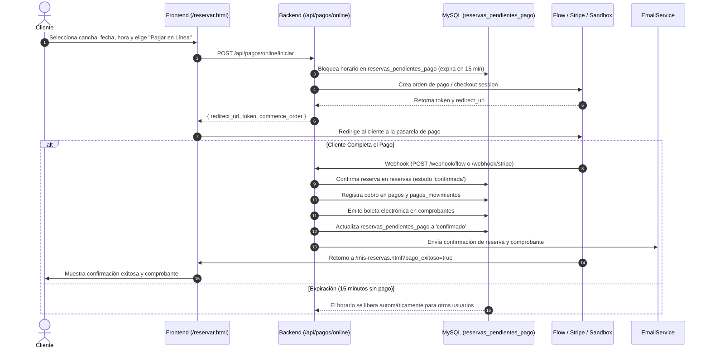

# Guía de Integraciones Externas — Pasarelas de Pago & Correo Transaccional

Esta guía detalla la arquitectura, configuración y puesta en marcha de los servicios externos integrados en la plataforma **SportReserve**: pasarelas de pago en línea (**Flow** y **Stripe**) y proveedores de correo electrónico transaccional (**Resend** y **Brevo**).

---

## 1. Filosofía de Integración

Todos los servicios externos han sido implementados siguiendo los siguientes principios:
1. **Desacoplamiento Plug & Play**: La plataforma funciona al 100% en modo local/desarrollo sin necesidad de contratar servicios de terceros ni añadir credenciales obligatorias.
2. **Cero Dependencias Pesadas**: Tanto los envíos de correo como las llamadas a pasarelas se realizan mediante `fetch` nativo de **Node.js 20**, reduciendo la superficie de ataque y el tamaño de la imagen Docker.
3. **Modos de Simulación Integrados (Mock & Sandbox)**: En desarrollo, el sistema emula los pagos con una interfaz interactiva de checkout y registra los correos en la consola de Docker.
4. **Activación Inmediata**: En cuanto se introducen las credenciales en el archivo `.env`, el sistema activa el proveedor real en caliente sin modificar el código.

---

## 2. Pasarela de Pago Online

### 2.1 Proveedores Soportados

| Proveedor | Enfoque | Moneda / Métodos | Modo Recomendado |
|---|---|---|---|
| **Flow** | Chile y Latinoamérica | PEN, CLP, USD (Webpay, Tarjetas, Mach, Khipu) | Producción regional |
| **Stripe** | Global / Internacional | Tarjetas de crédito/débito internacionales | Producción global |
| **Mock Simulator** | Desarrollo local y pruebas | Simulación interactiva aprobada/rechazada | Desarrollo / QA |

---

### 2.2 Ciclo de Vida del Pago Online



---

### 2.3 Configuración de Flow (Chile / LatAm)

1. **Crear cuenta de desarrollo**:
   - Ingresa a [Flow Sandbox](https://sandbox.flow.cl/) y regístrate como comercio de pruebas.
2. **Obtener credenciales**:
   - Ve a **Configuración > Seguridad / API** y copia tu **ApiKey** y tu **SecretKey**.
3. **Configurar `.env`**:
   ```env
   PAYMENT_GATEWAY_PROVIDER=flow
   FLOW_API_KEY=tu_api_key_de_flow
   FLOW_SECRET_KEY=tu_secret_key_de_flow
   FLOW_ENV=sandbox
   APP_URL=http://localhost:3000
   ```
4. **Para producción**:
   - Cambia `FLOW_ENV=production` y coloca tus llaves comerciales de [flow.cl](https://www.flow.cl).

---

### 2.4 Configuración de Stripe (Tarjetas Globales)

1. **Crear cuenta en Stripe**:
   - Ingresa a [Stripe Dashboard](https://dashboard.stripe.com/) y asegúrate de estar en modo **Test**.
2. **Obtener API Keys**:
   - Ve a **Developers > API Keys** y copia la **Secret Key** (`sk_test_...`).
3. **Configurar Webhook**:
   - En **Developers > Webhooks**, agrega un endpoint que apunte a:
     `https://tu-dominio.com/api/pagos/online/webhook/stripe`
   - Selecciona el evento: `checkout.session.completed`.
   - Copia el **Signing Secret** (`whsec_...`).
4. **Configurar `.env`**:
   ```env
   PAYMENT_GATEWAY_PROVIDER=stripe
   STRIPE_SECRET_KEY=sk_test_tu_clave_secreta
   STRIPE_WEBHOOK_SECRET=whsec_tu_firma_de_webhook
   APP_URL=http://localhost:3000
   ```

---

### 2.5 Modo Mock Simulator (Sin Credenciales)

Por defecto, la variable `PAYMENT_GATEWAY_PROVIDER` está configurada como `mock`. En este modo:
1. El cliente inicia una reserva con "Pagar en Línea" en `/reservar.html`.
2. El sistema lo redirige a la página interna de simulación:
   `http://localhost:3000/api/pagos/online/sandbox-checkout?token=...`
3. La página muestra el desglose del monto, la cancha y el horario.
4. Al hacer clic en **"💳 Simular Pago Aprobado"**, el sistema ejecuta la misma lógica de confirmación transaccional:
   - Crea la reserva en estado `confirmada`.
   - Registra el pago en `pagos` y `pagos_movimientos`.
   - Emite la boleta en `comprobantes`.
   - Redirige a `/mis-reservas.html` con mensaje de éxito.

---

## 3. Servicio de Correo Transaccional

### 3.1 Proveedores Soportados

| Proveedor | API Endpoint | Beneficios | Modo |
|---|---|---|---|
| **Resend** | `api.resend.com/emails` | API moderna, excelente entregabilidad, 3,000 correos gratis/mes | Producción |
| **Brevo** | `api.brevo.com/v3/smtp/email` | Servidores en la UE, 300 correos gratis/día | Producción |
| **Mock** | Consola local | Cero configuración, inspección visual en logs de Docker | Desarrollo |

---

### 3.2 Tipos de Correo Emitidos Automáticamente

1. **Confirmación de Reserva**:
   - Enviado tras confirmar una reserva en línea o en recepción.
   - Incluye código de reserva, sede, cancha, fecha, horario y montos.
2. **Constancia de Comprobante de Pago**:
   - Enviado al registrar un pago completo o un adelanto.
   - Incluye número de boleta/factura, referencia de operación y monto abonado.
3. **Aviso de Cancelación**:
   - Enviado cuando un cliente o administrador cancela un turno.
   - Incluye confirmación de horario liberado y detalle de reembolso o cupón compensatorio emitido.

---

### 3.3 Configuración de Resend

1. Crea una cuenta gratuita en [Resend](https://resend.com/).
2. Ve a **API Keys** y genera una nueva llave con permisos de envío (`re_...`).
3. *(Recomendado para producción)*: Agrega tu dominio en **Domains** y configura los registros DNS (DKIM, SPF).
4. Configura tu `.env`:
   ```env
   EMAIL_PROVIDER=resend
   EMAIL_FROM=reservas@tudominio.com
   EMAIL_FROM_NAME="SportReserve Platform"
   RESEND_API_KEY=re_123456789abcdef
   ```

---

### 3.4 Configuración de Brevo (Sendinblue)

1. Crea una cuenta en [Brevo](https://www.brevo.com/).
2. Ve a **Configuración > SMTP & API > API Keys** y genera una nueva clave (`xkeysib-...`).
3. Verifica la dirección de correo remitente en **Senders & IP**.
4. Configura tu `.env`:
   ```env
   EMAIL_PROVIDER=brevo
   EMAIL_FROM=tu_correo_verificado@tudominio.com
   EMAIL_FROM_NAME="SportReserve Platform"
   BREVO_API_KEY=xkeysib-123456789abcdef
   ```

---

### 3.5 Modo Mock de Correo (Logs en Docker)

Cuando `EMAIL_PROVIDER=mock` (por defecto):
- Los correos no se envían al internet ni generan costos.
- Se imprime una traza estructurada en los logs del backend:
  ```text
  📧 [EMAIL MOCK SIMULATION] =======================================
   Destinatario: cliente@ejemplo.com
   Remitente:    SportReserve Platform <reservas@sportreserve.com>
   Asunto:       ⚽ Reserva Confirmada [RES-2026-0042] — Complejo Norte
   Proveedor:    Simulado (Agrega RESEND_API_KEY o BREVO_API_KEY en .env)
   ID Generado:  mock-1730145230-abcde
  ===================================================================
  ```
- Para ver los correos simulados en tiempo real:
  ```bash
  docker compose logs -f backend
  ```

---

## 4. Matriz de Variables de Entorno de Integración

| Variable | Descripción | Valor por Defecto | Proveedor Asociado |
|---|---|---|---|
| `APP_URL` | URL base accesible del sistema (para retornos y webhooks) | `http://localhost:3000` | Pasarelas |
| `PAYMENT_GATEWAY_PROVIDER` | Driver de pasarela a utilizar (`mock`, `flow`, `stripe`) | `mock` | Pasarela |
| `FLOW_API_KEY` | Llave pública comercial de Flow | *(vacío)* | Flow |
| `FLOW_SECRET_KEY` | Llave secreta para firma HMAC de Flow | *(vacío)* | Flow |
| `FLOW_ENV` | Entorno de Flow (`sandbox` o `production`) | `sandbox` | Flow |
| `STRIPE_SECRET_KEY` | Clave secreta de Stripe (`sk_test_...` o `sk_live_...`) | *(vacío)* | Stripe |
| `STRIPE_WEBHOOK_SECRET` | Firma de verificación de eventos webhook Stripe | *(vacío)* | Stripe |
| `EMAIL_PROVIDER` | Driver de correo (`mock`, `resend`, `brevo`) | `mock` | Email |
| `EMAIL_FROM` | Dirección de correo del remitente | `reservas@sportreserve.com` | Email |
| `EMAIL_FROM_NAME` | Nombre visible del remitente en la bandeja de entrada | `"SportReserve Platform"` | Email |
| `RESEND_API_KEY` | API Key de Resend (`re_...`) | *(vacío)* | Resend |
| `BREVO_API_KEY` | API Key de Brevo (`xkeysib-...`) | *(vacío)* | Brevo |

