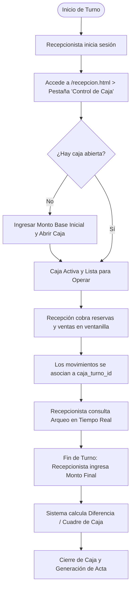
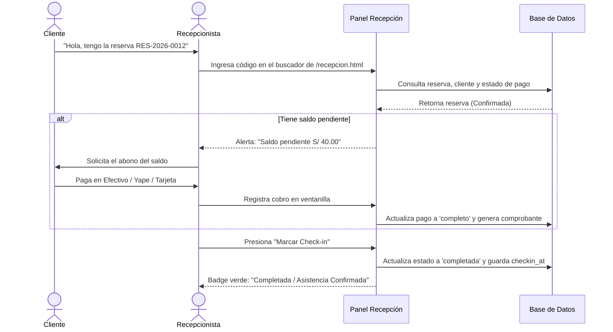

# Manual de Operaciones & Guía de Roles — SportReserve

Este manual describe los procesos operativos, la matriz de permisos y los flujos de trabajo del día a día para la gestión de complejos deportivos con **SportReserve**.

---

## 1. Matriz de Roles & Permisos (RBAC)

La plataforma cuenta con un sistema de autorización basado en 4 niveles de acceso:

| Módulo / Capacidad | Superadmin | Administrador | Recepcionista | Cliente |
|---|:---:|:---:|:---:|:---:|
| **Crear / Editar Negocios** | ✅ | ❌ | ❌ | ❌ |
| **Crear / Editar Canchas de la Sede** | ✅ | ✅ | ❌ | ❌ |
| **Configurar Tarifas y Horarios** | ✅ | ✅ | ❌ | ❌ |
| **Emitir Promociones y Cupones** | ✅ | ✅ | ❌ | ❌ |
| **Ver Métricas & KPIs Financieros** | ✅ (Todos) | ✅ (Su sede) | ❌ | ❌ |
| **Apertura, Arqueo y Cierre de Caja** | ✅ | ✅ | ✅ | ❌ |
| **Check-in de Asistencia en Cancha** | ✅ | ✅ | ✅ | ❌ |
| **Cobro de Saldos en Ventanilla** | ✅ | ✅ | ✅ | ❌ |
| **Reserva Presencial en Ventanilla** | ✅ | ✅ | ✅ | ❌ |
| **Reserva Online de Canchas** | ✅ | ✅ | ✅ | ✅ |
| **Consultar Historial Personal** | ✅ | ✅ | ✅ | ✅ |
| **Cancelar Reserva Propia** | ✅ | ✅ | ✅ | ✅ (Sujeto a política) |
| **Emitir Notas de Crédito / Reembolso**| ✅ | ✅ | ❌ | ❌ |

---

## 2. Flujo Operativo de Caja (Recepción)

El módulo de caja garantiza que ningún cobro presencial se realice sin un turno formalmente abierto y vinculado al recepcionista de turno.

### 2.1 Pasos para Abrir Turno de Caja
1. Iniciar sesión con perfil de **Recepcionista** o **Admin**.
2. Dirigirse al menú superior **Recepción & Caja** (`/recepcion.html`).
3. Hacer clic en la pestaña **💰 Control de Caja**.
4. Si la caja está cerrada, ingresar el **Monto Inicial en Efectivo** (fondo de cambio) y presionar **Abrir Turno de Caja**.
5. A partir de este momento, todos los cobros en ventanilla quedarán auditados bajo este turno.

### 2.2 Pasos para el Arqueo y Cierre de Caja
1. Al término del turno, acceder a **Control de Caja**.
2. Revisar el resumen de cobros agrupado por método:
   - Total Efectivo recaudado.
   - Total Tarjeta / POS.
   - Total Billeteras Digitales (Yape / Plin).
   - Total Transferencias bancarias.
3. Presionar **Cerrar Turno de Caja**:
   - Ingresar el conteo físico del efectivo disponible.
   - El sistema calculará automáticamente si existe sobrante o faltante.
   - Presionar **Confirmar Cierre de Caja**.

---

## 3. Flujo de Check-in & Asistencia de Clientes

El check-in valida la llegada física de los jugadores al complejo y asegura que no queden saldos impagos antes de ingresar al campo.

---

## 4. Política de Cancelaciones y Compensaciones

### 4.1 Reglas de Cancelación
- **Anticipación Mínima**: Un cliente puede cancelar su reserva directamente desde la web (`/mis-reservas.html`) siempre que falten **al menos 2 horas** para el inicio del horario pactado.
- **Cancelaciones Fuera de Plazo**: Si faltan menos de 2 horas, el cliente debe comunicarse con la administración de la sede para evaluar una reprogramación según disponibilidad.

### 4.2 Modalidades de Compensación
Cuando se cancela una reserva previamente pagada:
1. **Cupón de Descuento Compensatorio (Recomendado)**:
   - Se emite un código único (ej. `COMP-123456`) por el 100% del monto pagado.
   - El cliente puede canjearlo en cualquier momento para reservar otro horario en la misma sede.
   - No genera salida de efectivo de la caja del centro deportivo.
2. **Reembolso Directo (Efectivo / Transferencia)**:
   - Aplicable exclusivamente por el **Administrador** de la sede.
   - Emite una **Nota de Crédito electrónica** vinculada a la boleta original.
   - Registra el egreso de dinero en el módulo financiero.

---

## 5. Gestión del Catálogo de Canchas (Administradores)

Desde el panel **Administración** (`/admin.html > Gestión de Canchas`), los administradores de sede pueden:

1. **Crear Nueva Cancha**:
   - Nombre de la cancha (ej. *Cancha Sintética Pro 1*).
   - Deporte asociado (Fútbol 7, Pádel, etc.).
   - Tarifa por hora en Soles (PEN).
   - Horarios de apertura y cierre (ej. 07:00 a 23:00).
   - Características técnicas: Césped sintético monofilamento, techada, reflectores LED.
2. **Cambiar Estados de Operación**:
   - `disponible`: Abierta a reservas online y presenciales.
   - `mantenimiento`: Bloqueada temporalmente para mantenimiento de césped o luminarias. Los clientes no podrán seleccionarla.
   - `inactiva`: Oculta permanentemente del catálogo público.

---

## 6. Dashboard de Métricas & Reportes Financieros

Ubicado en `/admin.html > Métricas & KPIs`, permite filtrar por rango de fechas (desde / hasta):

- **Ingresos Totales**: Sumatoria de todos los pagos confirmados en el período.
- **Volumen de Reservas**: Total de horarios registrados, desglosados en *Completadas*, *Confirmadas*, *Pendientes* y *Canceladas*.
- **Desglose por Método de Cobro**:
  - Comparativa de volumen recaudado por Efectivo, Tarjeta, Yape/Plin y Transferencia.
- **Rendimiento por Cancha**:
  - Tabla de canchas ordenadas de mayor a menor recaudación y número de turnos jugados, permitiendo identificar los espacios más rentables del centro deportivo.
