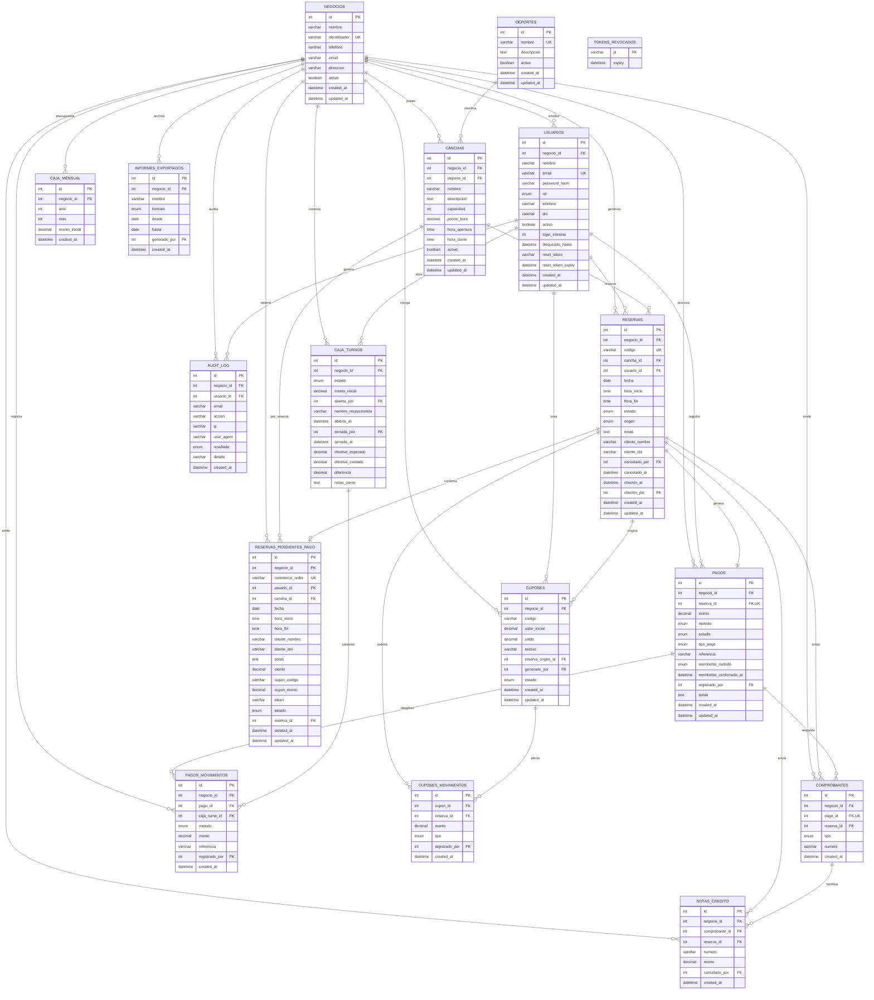

# Modelo Relacional de Datos — Plataforma Multi-Negocio de Reservas Deportivas

## 1. Visión General y Enfoque de Arquitectura

El presente modelo de base de datos define la arquitectura de persistencia para una plataforma de reservas de espacios deportivos diseñada bajo un paradigma **general y multi-negocio** (*multi-tenant*).

### Principios Fundamentales de Diseño
1. **Generalidad e Independencia de Marca**: Se elimina cualquier referencia a entidades o complejos deportivos específicos, estructurando un sistema neutro y extensible.
2. **Multi-Negocio (Multi-Tenant)**: 
   - Aislamiento lógico de datos mediante la clave foránea `negocio_id` en todas las entidades operativas y transaccionales (`canchas`, `reservas`, `pagos`, `caja_turnos`, `cupones`, `comprobantes`, etc.).
   - Soporte para numeración fiscal y códigos únicos por negocio (p. ej., números de comprobante o códigos de cupones con unicidad compuesta `[negocio_id, numero]`).
3. **Gestión de Identidad y Roles**:
   - **Clientes**: Poseen una cuenta global (`negocio_id = NULL`), lo que les permite consultar disponibilidad y reservar canchas en múltiples complejos deportivos con un único inicio de sesión.
   - **Personal Operativo (`admin`, `recepcionista`)**: Cuentas asociadas directamente al negocio que administran (`negocio_id NOT NULL`).
   - **Superadministrador (`superadmin`)**: Rol de supervisión global de la plataforma para alta de negocios y auditoría general (`negocio_id = NULL`).
4. **Catálogo Deportivo Normalizado (`deportes`)**: Desacoplamiento de las disciplinas deportivas de estructuras rígidas tipo `ENUM` hacia una tabla de catálogo para permitir la incorporación dinámica de deportes (fútbol, pádel, tenis, básquetbol, vóleibol, etc.).
5. **Control de Caja y Trazabilidad Financiera**: 
   - Seguimiento riguroso de turnos de caja (`caja_turnos`) con arqueos, diferencias y registros detallados por método de cobro (`pagos_movimientos`).
   - Soporte para balance base mensual (`caja_mensual`) segmentado por negocio.
6. **Seguridad y Auditoría**: Inclusión de tablas para lista negra de tokens JWT revocados (`tokens_revocados`) y bitácora de auditoría detallada (`audit_log`).

---

## 2. Diagrama Entidad-Relación (ER)



---

## 3. Diccionario de Datos

### 3.1 `negocios`
Entidad principal que modela cada centro deportivo o negocio suscrito a la plataforma.

| Campo | Tipo | Nulo | Default | Descripción |
|---|---|---|---|---|
| `id` | `INT` | No | AUTO_INCREMENT | Clave primaria. |
| `nombre` | `VARCHAR(120)` | No | | Nombre comercial del negocio. |
| `identificador` | `VARCHAR(80)` | No | | Slug único para URLs e identificación en API. |
| `telefono` | `VARCHAR(20)` | Sí | NULL | Teléfono de contacto o atención al cliente. |
| `email` | `VARCHAR(150)` | Sí | NULL | Correo de contacto administrativo. |
| `direccion` | `VARCHAR(255)` | Sí | NULL | Dirección física o ubicación del establecimiento. |
| `activo` | `BOOLEAN` | No | `TRUE` | Estado operativo del negocio. |
| `created_at` | `DATETIME` | No | `CURRENT_TIMESTAMP` | Fecha y hora de creación. |
| `updated_at` | `DATETIME` | No | `CURRENT_TIMESTAMP` | Fecha y hora de última modificación. |

**Restricciones e Índices:**
- `PRIMARY KEY (id)`
- `UNIQUE KEY uq_negocios_identificador (identificador)`

---

### 3.2 `deportes`
Catálogo unificado de disciplinas deportivas disponibles en la plataforma.

| Campo | Tipo | Nulo | Default | Descripción |
|---|---|---|---|---|
| `id` | `INT` | No | AUTO_INCREMENT | Clave primaria. |
| `nombre` | `VARCHAR(50)` | No | | Nombre de la disciplina (Fútbol, Pádel, Tenis, etc.). |
| `descripcion` | `TEXT` | Sí | NULL | Información descriptiva o reglas generales. |
| `activo` | `BOOLEAN` | No | `TRUE` | Permite habilitar o inhabilitar la disciplina. |
| `created_at` | `DATETIME` | No | `CURRENT_TIMESTAMP` | Fecha de registro. |
| `updated_at` | `DATETIME` | No | `CURRENT_TIMESTAMP` | Fecha de actualización. |

**Restricciones e Índices:**
- `PRIMARY KEY (id)`
- `UNIQUE KEY uq_deportes_nombre (nombre)`

---

### 3.3 `usuarios`
Cuentas de acceso y credenciales de autenticación.

| Campo | Tipo | Nulo | Default | Descripción |
|---|---|---|---|---|
| `id` | `INT` | No | AUTO_INCREMENT | Clave primaria. |
| `negocio_id` | `INT` | Sí | NULL | FK a `negocios(id)`. NULL para clientes y superadmin. |
| `nombre` | `VARCHAR(100)` | No | | Nombre completo del usuario. |
| `email` | `VARCHAR(150)` | No | | Correo electrónico único para inicio de sesión. |
| `password_hash` | `VARCHAR(255)` | No | | Hash seguro de la contraseña. |
| `rol` | `ENUM` | No | `'cliente'` | `'superadmin'`, `'admin'`, `'recepcionista'`, `'cliente'`. |
| `telefono` | `VARCHAR(20)` | Sí | NULL | Teléfono móvil. |
| `dni` | `VARCHAR(15)` | Sí | NULL | Documento de identidad fiscal o nacional. |
| `activo` | `BOOLEAN` | No | `TRUE` | Indicador de cuenta activa. |
| `login_intentos` | `INT` | No | `0` | Contador de intentos fallidos consecutivos de login. |
| `bloqueado_hasta`| `DATETIME` | Sí | NULL | Marca temporal de bloqueo preventivo por intentos. |
| `reset_token` | `VARCHAR(255)` | Sí | NULL | Token para recuperación de contraseña. |
| `reset_token_expiry`| `DATETIME` | Sí | NULL | Vencimiento del token de recuperación. |
| `created_at` | `DATETIME` | No | `CURRENT_TIMESTAMP` | Fecha de registro. |
| `updated_at` | `DATETIME` | No | `CURRENT_TIMESTAMP` | Fecha de actualización. |

**Restricciones e Índices:**
- `PRIMARY KEY (id)`
- `UNIQUE KEY uq_usuarios_email (email)`
- `FOREIGN KEY (negocio_id) REFERENCES negocios(id) ON DELETE SET NULL`
- `INDEX idx_usuarios_rol (rol)`
- `INDEX idx_usuarios_negocio (negocio_id)`

---

### 3.4 `canchas`
Espacios deportivos y canchas que administra cada negocio.

| Campo | Tipo | Nulo | Default | Descripción |
|---|---|---|---|---|
| `id` | `INT` | No | AUTO_INCREMENT | Clave primaria. |
| `negocio_id` | `INT` | No | | FK a `negocios(id)`. |
| `deporte_id` | `INT` | No | | FK a `deportes(id)`. |
| `nombre` | `VARCHAR(100)` | No | | Denominación de la cancha (p. ej. "Cancha 1 Sintética"). |
| `descripcion` | `TEXT` | Sí | NULL | Detalles técnicos, iluminación, techado o vestuarios. |
| `capacidad` | `INT` | No | `10` | Cantidad recomendada de jugadores. |
| `precio_hora` | `DECIMAL(10,2)`| No | | Tarifa base de alquiler por hora. |
| `hora_apertura`| `TIME` | No | `'07:00:00'` | Horario de inicio de atención. |
| `hora_cierre` | `TIME` | No | `'23:00:00'` | Horario de fin de atención. |
| `activo` | `BOOLEAN` | No | `TRUE` | Disponibilidad operativa de la cancha. |
| `created_at` | `DATETIME` | No | `CURRENT_TIMESTAMP` | Fecha de creación. |
| `updated_at` | `DATETIME` | No | `CURRENT_TIMESTAMP` | Fecha de actualización. |

**Restricciones e Índices:**
- `PRIMARY KEY (id)`
- `FOREIGN KEY (negocio_id) REFERENCES negocios(id) ON DELETE RESTRICT`
- `FOREIGN KEY (deporte_id) REFERENCES deportes(id) ON DELETE RESTRICT`
- `INDEX idx_canchas_negocio (negocio_id)`
- `INDEX idx_canchas_deporte (deporte_id)`
- `INDEX idx_canchas_activo (activo)`

---

### 3.5 `reservas`
Núcleo operativo del alquiler de canchas.

| Campo | Tipo | Nulo | Default | Descripción |
|---|---|---|---|---|
| `id` | `INT` | No | AUTO_INCREMENT | Clave primaria. |
| `negocio_id` | `INT` | No | | FK a `negocios(id)`. |
| `codigo` | `VARCHAR(20)` | No | | Código alfanumérico único de reserva (localizador). |
| `cancha_id` | `INT` | No | | FK a `canchas(id)`. |
| `usuario_id` | `INT` | No | | FK a `usuarios(id)`. |
| `fecha` | `DATE` | No | | Fecha programada del juego. |
| `hora_inicio` | `TIME` | No | | Hora programada de inicio. |
| `hora_fin` | `TIME` | No | | Hora programada de fin. |
| `estado` | `ENUM` | No | `'pendiente'` | `'pendiente'`, `'confirmada'`, `'cancelada'`, `'completada'`, `'pendiente_reembolso'`. |
| `origen` | `ENUM` | No | `'linea'` | `'linea'`, `'recepcion'`. |
| `notas` | `TEXT` | Sí | NULL | Observaciones de la reserva. |
| `cliente_nombre`| `VARCHAR(100)`| Sí | NULL | Nombre de contacto cuando se atiende por ventanilla. |
| `cliente_dni` | `VARCHAR(15)` | Sí | NULL | Identificación de contacto por ventanilla. |
| `cancelado_por` | `INT` | Sí | NULL | FK a `usuarios(id)` del personal o cliente que canceló. |
| `cancelado_at` | `DATETIME` | Sí | NULL | Fecha y hora de cancelación. |
| `checkin_at` | `DATETIME` | Sí | NULL | Fecha y hora en la que se confirmó asistencia. |
| `checkin_por` | `INT` | Sí | NULL | FK a `usuarios(id)` del recepcionista que registró check-in. |
| `created_at` | `DATETIME` | No | `CURRENT_TIMESTAMP` | Fecha de creación. |
| `updated_at` | `DATETIME` | No | `CURRENT_TIMESTAMP` | Fecha de actualización. |

**Restricciones e Índices:**
- `PRIMARY KEY (id)`
- `UNIQUE KEY uq_reservas_codigo (codigo)`
- `FOREIGN KEY (negocio_id) REFERENCES negocios(id) ON DELETE RESTRICT`
- `FOREIGN KEY (cancha_id) REFERENCES canchas(id) ON DELETE RESTRICT`
- `FOREIGN KEY (usuario_id) REFERENCES usuarios(id) ON DELETE RESTRICT`
- `FOREIGN KEY (cancelado_por) REFERENCES usuarios(id) ON DELETE SET NULL`
- `FOREIGN KEY (checkin_por) REFERENCES usuarios(id) ON DELETE SET NULL`
- `INDEX idx_reservas_negocio_fecha (negocio_id, fecha)`
- `INDEX idx_reservas_slot (cancha_id, fecha, hora_inicio)`
- `INDEX idx_reservas_usuario (usuario_id)`
- `INDEX idx_reservas_estado (estado)`

---

### 3.6 `pagos`
Registro financiero principal vinculado a una reserva.

| Campo | Tipo | Nulo | Default | Descripción |
|---|---|---|---|---|
| `id` | `INT` | No | AUTO_INCREMENT | Clave primaria. |
| `negocio_id` | `INT` | No | | FK a `negocios(id)`. |
| `reserva_id` | `INT` | No | | FK a `reservas(id)`, relación 1 a 1. |
| `monto` | `DECIMAL(10,2)`| No | | Importe total registrado. |
| `metodo` | `ENUM` | No | | `'efectivo'`, `'transferencia'`, `'yape'`, `'plin'`, `'tarjeta'`, `'flow'`, `'mixto'`, `'cupon'`. |
| `estado` | `ENUM` | No | `'pendiente'` | `'pendiente'`, `'pagado'`, `'reembolsado'`. |
| `tipo_pago` | `ENUM` | Sí | NULL | `'completo'`, `'adelanto'`. |
| `referencia` | `VARCHAR(100)` | Sí | NULL | Código de operación bancaria o pasarela. |
| `reembolso_metodo` | `ENUM` | Sí | NULL | `'efectivo'`, `'transferencia'`, `'cupon'`. |
| `reembolso_confirmado_at` | `DATETIME` | Sí | NULL | Fecha de confirmación del reembolso. |
| `registrado_por` | `INT` | Sí | NULL | FK a `usuarios(id)` del recepcionista/cajero. |
| `notas` | `TEXT` | Sí | NULL | Observaciones del pago. |
| `created_at` | `DATETIME` | No | `CURRENT_TIMESTAMP` | Fecha de creación. |
| `updated_at` | `DATETIME` | No | `CURRENT_TIMESTAMP` | Fecha de actualización. |

**Restricciones e Índices:**
- `PRIMARY KEY (id)`
- `UNIQUE KEY uq_pagos_reserva (reserva_id)`
- `FOREIGN KEY (negocio_id) REFERENCES negocios(id) ON DELETE RESTRICT`
- `FOREIGN KEY (reserva_id) REFERENCES reservas(id) ON DELETE RESTRICT`
- `FOREIGN KEY (registrado_por) REFERENCES usuarios(id) ON DELETE SET NULL`
- `INDEX idx_pagos_negocio_estado (negocio_id, estado)`
- `INDEX idx_pagos_metodo (metodo)`

---

### 3.7 `comprobantes`
Boletas o facturas asociadas a un cobro.

| Campo | Tipo | Nulo | Default | Descripción |
|---|---|---|---|---|
| `id` | `INT` | No | AUTO_INCREMENT | Clave primaria. |
| `negocio_id` | `INT` | No | | FK a `negocios(id)`. |
| `pago_id` | `INT` | No | | FK a `pagos(id)` (relación 1:1 con comprobante). |
| `reserva_id` | `INT` | No | | FK a `reservas(id)`. |
| `tipo` | `ENUM` | No | `'boleta'` | `'boleta'`, `'factura'`. |
| `numero` | `VARCHAR(50)` | No | | Correlativo del documento fiscal/interno. |
| `created_at` | `DATETIME` | No | `CURRENT_TIMESTAMP` | Fecha de emisión. |

**Restricciones e Índices:**
- `PRIMARY KEY (id)`
- `UNIQUE KEY uq_comprobante_pago (pago_id)`
- `UNIQUE KEY uq_comprobante_negocio_numero (negocio_id, numero)`
- `FOREIGN KEY (negocio_id) REFERENCES negocios(id) ON DELETE RESTRICT`
- `FOREIGN KEY (pago_id) REFERENCES pagos(id) ON DELETE RESTRICT`
- `FOREIGN KEY (reserva_id) REFERENCES reservas(id) ON DELETE RESTRICT`
- `INDEX idx_comprobantes_reserva (reserva_id)`

---

### 3.8 `notas_credito`
Documentos emitidos ante cancelaciones o reembolsos totales o parciales.

| Campo | Tipo | Nulo | Default | Descripción |
|---|---|---|---|---|
| `id` | `INT` | No | AUTO_INCREMENT | Clave primaria. |
| `negocio_id` | `INT` | No | | FK a `negocios(id)`. |
| `comprobante_id`| `INT` | No | | FK a `comprobantes(id)`. |
| `reserva_id` | `INT` | No | | FK a `reservas(id)`. |
| `numero` | `VARCHAR(50)` | No | | Correlativo único de la nota de crédito por negocio. |
| `monto` | `DECIMAL(10,2)`| No | | Importe de anulación/crédito. |
| `cancelado_por` | `INT` | No | | FK a `usuarios(id)` del personal autorizante. |
| `created_at` | `DATETIME` | No | `CURRENT_TIMESTAMP` | Fecha de emisión. |

**Restricciones e Índices:**
- `PRIMARY KEY (id)`
- `UNIQUE KEY uq_nota_credito_negocio_numero (negocio_id, numero)`
- `FOREIGN KEY (negocio_id) REFERENCES negocios(id) ON DELETE RESTRICT`
- `FOREIGN KEY (comprobante_id) REFERENCES comprobantes(id) ON DELETE RESTRICT`
- `FOREIGN KEY (reserva_id) REFERENCES reservas(id) ON DELETE RESTRICT`
- `FOREIGN KEY (cancelado_por) REFERENCES usuarios(id) ON DELETE RESTRICT`

---

### 3.9 `caja_turnos`
Apertura, arqueo y cierre operativo de turnos de recepción.

| Campo | Tipo | Nulo | Default | Descripción |
|---|---|---|---|---|
| `id` | `INT` | No | AUTO_INCREMENT | Clave primaria. |
| `negocio_id` | `INT` | No | | FK a `negocios(id)`. |
| `estado` | `ENUM` | No | `'abierta'` | `'abierta'`, `'cerrada'`. |
| `monto_inicial` | `DECIMAL(10,2)`| No | `0.00` | Fondo inicial de caja al abrir turno. |
| `abierta_por` | `INT` | No | | FK a `usuarios(id)` del recepcionista que abre caja. |
| `nombre_recepcionista` | `VARCHAR(100)` | Sí | NULL | Nombre capturado al momento del turno. |
| `abierta_at` | `DATETIME` | No | `CURRENT_TIMESTAMP` | Momento de apertura. |
| `cerrada_por` | `INT` | Sí | NULL | FK a `usuarios(id)` que ejecuta el cierre de caja. |
| `cerrada_at` | `DATETIME` | Sí | NULL | Momento de cierre. |
| `efectivo_esperado` | `DECIMAL(10,2)` | Sí | NULL | Total calculado por sistema. |
| `efectivo_contado` | `DECIMAL(10,2)` | Sí | NULL | Total físico verificado por el cajero. |
| `diferencia` | `DECIMAL(10,2)` | Sí | NULL | Descuadre (sobrante o faltante). |
| `notas_cierre` | `TEXT` | Sí | NULL | Justificaciones o comentarios de cierre. |

**Restricciones e Índices:**
- `PRIMARY KEY (id)`
- `FOREIGN KEY (negocio_id) REFERENCES negocios(id) ON DELETE RESTRICT`
- `FOREIGN KEY (abierta_por) REFERENCES usuarios(id) ON DELETE RESTRICT`
- `FOREIGN KEY (cerrada_por) REFERENCES usuarios(id) ON DELETE SET NULL`
- `INDEX idx_caja_turnos_negocio_estado (negocio_id, estado)`
- `INDEX idx_caja_turnos_abierta_at (abierta_at)`

---

### 3.10 `pagos_movimientos`
Desglose atómico de pagos fraccionados o mixtos imputados a un turno de caja.

| Campo | Tipo | Nulo | Default | Descripción |
|---|---|---|---|---|
| `id` | `INT` | No | AUTO_INCREMENT | Clave primaria. |
| `negocio_id` | `INT` | No | | FK a `negocios(id)`. |
| `pago_id` | `INT` | No | | FK a `pagos(id)`. |
| `caja_turno_id`| `INT` | Sí | NULL | FK a `caja_turnos(id)` al que tributa el ingreso. |
| `metodo` | `ENUM` | No | | `'efectivo'`, `'transferencia'`, `'yape'`, `'plin'`, `'tarjeta'`, `'flow'`, `'cupon'`. |
| `monto` | `DECIMAL(10,2)`| No | | Importe de este movimiento particular. |
| `referencia` | `VARCHAR(100)` | Sí | NULL | Voucher, token o transacción externa. |
| `registrado_por`| `INT` | Sí | NULL | FK a `usuarios(id)` del recepcionista. |
| `created_at` | `DATETIME` | No | `CURRENT_TIMESTAMP` | Fecha de creación. |

**Restricciones e Índices:**
- `PRIMARY KEY (id)`
- `FOREIGN KEY (negocio_id) REFERENCES negocios(id) ON DELETE RESTRICT`
- `FOREIGN KEY (pago_id) REFERENCES pagos(id) ON DELETE RESTRICT`
- `FOREIGN KEY (caja_turno_id) REFERENCES caja_turnos(id) ON DELETE SET NULL`
- `FOREIGN KEY (registrado_por) REFERENCES usuarios(id) ON DELETE SET NULL`
- `INDEX idx_pagomov_caja (caja_turno_id)`
- `INDEX idx_pagomov_pago (pago_id)`
- `INDEX idx_pagomov_metodo (metodo)`

---

### 3.11 `cupones`
Vales o notas de crédito a favor de clientes para ser canjeados en reservas.

| Campo | Tipo | Nulo | Default | Descripción |
|---|---|---|---|---|
| `id` | `INT` | No | AUTO_INCREMENT | Clave primaria. |
| `negocio_id` | `INT` | No | | FK a `negocios(id)`. |
| `codigo` | `VARCHAR(30)` | No | | Código de cupón (único dentro del negocio). |
| `valor_inicial`| `DECIMAL(10,2)`| No | | Monto original otorgado. |
| `saldo` | `DECIMAL(10,2)`| No | | Saldo remanente disponible para consumo. |
| `motivo` | `VARCHAR(255)` | No | | Razón de emisión (p. ej. "Compensación por lluvia"). |
| `reserva_origen_id` | `INT` | No | | FK a `reservas(id)` que motivó la compensación. |
| `generado_por` | `INT` | No | | FK a `usuarios(id)` del administrador/recepcionista. |
| `estado` | `ENUM` | No | `'activo'` | `'activo'`, `'agotado'`, `'anulado'`. |
| `created_at` | `DATETIME` | No | `CURRENT_TIMESTAMP` | Fecha de emisión. |
| `updated_at` | `DATETIME` | No | `CURRENT_TIMESTAMP` | Fecha de última modificación. |

**Restricciones e Índices:**
- `PRIMARY KEY (id)`
- `UNIQUE KEY uq_cupon_negocio_codigo (negocio_id, codigo)`
- `FOREIGN KEY (negocio_id) REFERENCES negocios(id) ON DELETE RESTRICT`
- `FOREIGN KEY (reserva_origen_id) REFERENCES reservas(id) ON DELETE RESTRICT`
- `FOREIGN KEY (generado_por) REFERENCES usuarios(id) ON DELETE RESTRICT`
- `INDEX idx_cupones_negocio_estado (negocio_id, estado)`

---

### 3.12 `cupones_movimientos`
Historial de consumos, recargas o anulaciones sobre el saldo de un cupón.

| Campo | Tipo | Nulo | Default | Descripción |
|---|---|---|---|---|
| `id` | `INT` | No | AUTO_INCREMENT | Clave primaria. |
| `cupon_id` | `INT` | No | | FK a `cupones(id)`. |
| `reserva_id` | `INT` | Sí | NULL | FK a `reservas(id)` donde se aplicó el canje. |
| `monto` | `DECIMAL(10,2)`| No | | Importe del movimiento. |
| `tipo` | `ENUM` | No | | `'emision'`, `'canje'`, `'anulacion'`. |
| `registrado_por`| `INT` | Sí | NULL | FK a `usuarios(id)`. |
| `created_at` | `DATETIME` | No | `CURRENT_TIMESTAMP` | Fecha y hora del movimiento. |

**Restricciones e Índices:**
- `PRIMARY KEY (id)`
- `FOREIGN KEY (cupon_id) REFERENCES cupones(id) ON DELETE RESTRICT`
- `FOREIGN KEY (reserva_id) REFERENCES reservas(id) ON DELETE SET NULL`
- `FOREIGN KEY (registrado_por) REFERENCES usuarios(id) ON DELETE SET NULL`
- `INDEX idx_cuponmov_cupon (cupon_id)`
- `INDEX idx_cuponmov_reserva (reserva_id)`

---

### 3.13 `reservas_pendientes_pago`
Almacenamiento transitorio de intenciones de reserva mediante pasarela online externa.

| Campo | Tipo | Nulo | Default | Descripción |
|---|---|---|---|---|
| `id` | `INT` | No | AUTO_INCREMENT | Clave primaria. |
| `negocio_id` | `INT` | No | | FK a `negocios(id)`. |
| `commerce_order` | `VARCHAR(60)` | No | | Identificador de orden enviado a la pasarela externa. |
| `usuario_id` | `INT` | No | | FK a `usuarios(id)`. |
| `cancha_id` | `INT` | No | | FK a `canchas(id)`. |
| `fecha` | `DATE` | No | | Fecha solicitada. |
| `hora_inicio` | `TIME` | No | | Hora de inicio solicitada. |
| `hora_fin` | `TIME` | No | | Hora de término solicitada. |
| `cliente_nombre`| `VARCHAR(100)`| No | | Nombre del cliente. |
| `cliente_dni` | `VARCHAR(15)` | No | | Identificación del cliente. |
| `notas` | `TEXT` | Sí | NULL | Observaciones enviadas por el cliente. |
| `monto` | `DECIMAL(10,2)`| No | | Importe a abonar en la pasarela. |
| `cupon_codigo` | `VARCHAR(30)` | Sí | NULL | Código de cupón aplicado parcialmente. |
| `cupon_monto` | `DECIMAL(10,2)`| Sí | NULL | Descuento cubierto por cupón. |
| `token` | `VARCHAR(100)` | Sí | NULL | Token retornado por la pasarela de pagos. |
| `estado` | `ENUM` | No | `'pendiente'` | `'pendiente'`, `'confirmado'`, `'fallido'`, `'conflicto'`, `'expirado'`. |
| `reserva_id` | `INT` | Sí | NULL | FK a `reservas(id)` generada tras confirmación. |
| `created_at` | `DATETIME` | No | `CURRENT_TIMESTAMP` | Fecha de creación. |
| `updated_at` | `DATETIME` | No | `CURRENT_TIMESTAMP` | Fecha de actualización. |

**Restricciones e Índices:**
- `PRIMARY KEY (id)`
- `UNIQUE KEY uq_pendientes_order (commerce_order)`
- `FOREIGN KEY (negocio_id) REFERENCES negocios(id) ON DELETE RESTRICT`
- `FOREIGN KEY (usuario_id) REFERENCES usuarios(id) ON DELETE RESTRICT`
- `FOREIGN KEY (cancha_id) REFERENCES canchas(id) ON DELETE RESTRICT`
- `FOREIGN KEY (reserva_id) REFERENCES reservas(id) ON DELETE SET NULL`
- `INDEX idx_pendientes_negocio_estado (negocio_id, estado)`
- `INDEX idx_pendientes_slot (cancha_id, fecha, hora_inicio)`

---

### 3.14 `caja_mensual`
Fondo de reserva o presupuesto inicial contable establecido por mes en cada negocio.

| Campo | Tipo | Nulo | Default | Descripción |
|---|---|---|---|---|
| `id` | `INT` | No | AUTO_INCREMENT | Clave primaria. |
| `negocio_id` | `INT` | No | | FK a `negocios(id)`. |
| `anio` | `INT` | No | | Año fiscal (ej. 2026). |
| `mes` | `INT` | No | | Mes calendario (1 a 12). |
| `monto_inicial`| `DECIMAL(10,2)`| No | `0.00` | Saldo o presupuesto base fijado para el periodo. |
| `created_at` | `DATETIME` | No | `CURRENT_TIMESTAMP` | Fecha de creación. |

**Restricciones e Índices:**
- `PRIMARY KEY (id)`
- `UNIQUE KEY uq_caja_mes_negocio (negocio_id, anio, mes)`
- `FOREIGN KEY (negocio_id) REFERENCES negocios(id) ON DELETE RESTRICT`

---

### 3.15 `informes_exportados`
Registro de auditoría y descarga de reportes contables o ejecutivos generados.

| Campo | Tipo | Nulo | Default | Descripción |
|---|---|---|---|---|
| `id` | `INT` | No | AUTO_INCREMENT | Clave primaria. |
| `negocio_id` | `INT` | No | | FK a `negocios(id)`. |
| `nombre` | `VARCHAR(150)` | No | | Nombre descriptivo del archivo generado. |
| `formato` | `ENUM` | No | | `'pdf'`, `'excel'`, `'csv'`. |
| `desde` | `DATE` | No | | Fecha inicial del rango reportado. |
| `hasta` | `DATE` | No | | Fecha final del rango reportado. |
| `generado_por` | `INT` | Sí | NULL | FK a `usuarios(id)` del administrador solicitante. |
| `created_at` | `DATETIME` | No | `CURRENT_TIMESTAMP` | Momento de exportación. |

**Restricciones e Índices:**
- `PRIMARY KEY (id)`
- `FOREIGN KEY (negocio_id) REFERENCES negocios(id) ON DELETE RESTRICT`
- `FOREIGN KEY (generado_por) REFERENCES usuarios(id) ON DELETE SET NULL`
- `INDEX idx_informes_negocio (negocio_id, created_at)`

---

### 3.16 `audit_log`
Bitácora de seguridad y eventos operativos del sistema.

| Campo | Tipo | Nulo | Default | Descripción |
|---|---|---|---|---|
| `id` | `INT` | No | AUTO_INCREMENT | Clave primaria. |
| `negocio_id` | `INT` | Sí | NULL | FK a `negocios(id)`. NULL si es evento general o superadmin. |
| `usuario_id` | `INT` | Sí | NULL | FK a `usuarios(id)` que ejecutó la acción. |
| `email` | `VARCHAR(150)` | Sí | NULL | Correo informado o intentado. |
| `accion` | `VARCHAR(50)` | No | | Operación ejecutada (`LOGIN`, `LOGOUT`, `CANCEL_RESERVA`, etc.). |
| `ip` | `VARCHAR(45)` | Sí | NULL | Dirección IP de origen (IPv4 o IPv6). |
| `user_agent` | `VARCHAR(255)` | Sí | NULL | Cabecera del navegador o cliente HTTP. |
| `resultado` | `ENUM` | No | | `'exitoso'`, `'fallido'`. |
| `detalle` | `VARCHAR(255)` | Sí | NULL | Información complementaria o mensaje de error. |
| `created_at` | `DATETIME` | No | `CURRENT_TIMESTAMP` | Momento exacto del suceso. |

**Restricciones e Índices:**
- `PRIMARY KEY (id)`
- `FOREIGN KEY (negocio_id) REFERENCES negocios(id) ON DELETE SET NULL`
- `FOREIGN KEY (usuario_id) REFERENCES usuarios(id) ON DELETE SET NULL`
- `INDEX idx_audit_negocio (negocio_id)`
- `INDEX idx_audit_email (email)`
- `INDEX idx_audit_created (created_at)`

---

### 3.17 `tokens_revocados`
Control de revocación de sesiones JWT activas al momento de cerrar sesión.

| Campo | Tipo | Nulo | Default | Descripción |
|---|---|---|---|---|
| `jti` | `VARCHAR(64)` | No | | JWT ID único del token invalidado. Clave primaria. |
| `expiry` | `DATETIME` | No | | Fecha y hora en la que expira naturalmente el token. |

**Restricciones e Índices:**
- `PRIMARY KEY (jti)`
- `INDEX idx_tokens_expiry (expiry)`

---

## 4. Resumen de Mejoras y Cambios Respecto al Sistema Original

1. **Arquitectura Multi-Negocio Completa**:
   - Se diseñó la entidad `negocios` como raíz del inquilino (*tenant*).
   - Se incluyó `negocio_id` con integridad referencial en todas las entidades de dominio correspondientes.
   - Se redefinieron las restricciones de unicidad compuestas para comprobantes (`negocio_id`, `numero`), notas de crédito (`negocio_id`, `numero`), cupones (`negocio_id`, `codigo`) y caja mensual (`negocio_id`, `anio`, `mes`), permitiendo que cada negocio maneje su propia secuencia sin colisionar con otros.
2. **Normalización del Catálogo Deportivo**:
   - Reemplazo del tipo restrictivo `ENUM('futbol', 'basketball', 'volleyball')` por la entidad `deportes`, facilitando la escalabilidad a pádel, tenis, squash y cualquier otro deporte sin alterar el esquema relacional.
3. **Roles y Cuentas Globales vs. Locales**:
   - El rol `cliente` ahora opera transversalmente en la plataforma sin atarse a una única sede.
   - Los roles `admin` y `recepcionista` quedan asociados a su respectivo `negocio_id`.
   - Se introduce el rol `superadmin` para la gestión global de la plataforma multi-negocio.
4. **Esquema Unificado y Depurado**:
   - Se consolidaron todas las migraciones históricas (`init.sql` + migraciones 001 a 004 + `migrations.js`) en un único DDL limpio y atómico en `database/init.sql`.
   - Se mantuvieron los índices más eficientes para búsquedas de disponibilidad por slot, arqueo de turnos de caja y auditoría.
   - El esquema inicia 100% limpio, sin datos demo ni semillas hardcodeadas.

---

## 5. Instrucciones de Ejecución con Docker

### 5.1 Requisitos
- Docker y Docker Compose (o Colima en macOS).

### 5.2 Variables de Entorno
Copiar el archivo de plantilla `.env.example` a `.env`:
```bash
cp .env.example .env
```
Parámetros configurables:
- `MYSQL_ROOT_PASSWORD`: Contraseña para el usuario `root`.
- `MYSQL_DATABASE`: Nombre de la base de datos (por defecto: `reservas_db`).
- `MYSQL_USER`: Usuario de la aplicación.
- `MYSQL_PASSWORD`: Contraseña del usuario de la aplicación.
- `MYSQL_PORT`: Puerto expuesto en el host (por defecto `3307` para evitar colisiones con instancias MySQL locales existentes).

### 5.3 Iniciar la Base de Datos
Para construir e iniciar el contenedor en segundo plano:
```bash
docker compose up -d
```
El contenedor cargará automáticamente el esquema desde `database/init.sql` durante su inicialización.

### 5.4 Comprobar Estado y Conexión
Verificar que el contenedor esté saludable:
```bash
docker compose ps
```
Verificar los logs de inicialización:
```bash
docker compose logs -f db
```
Probar la conexión interactiva:
```bash
docker compose exec db mysql -u reservas_app -pdev_app_password reservas_db -e "SHOW TABLES;"
```
